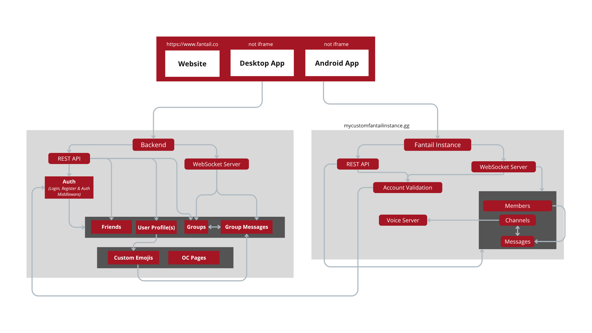

   <h1>
  Fantail
  
  
  
  
  
  
  
</h1>

A semi-decentralized, secure and privacy-first Discord alternative.

 

| Features         | State            | Coverage | Sub-features                                                                                   |
| ---------------- | ---------------- | -------- | ---------------------------------------------------------------------------------------------- |
| Authentication   | Done             | 100%     | Login, Register, Middleware                                                                    |
| Friend Requests  | Near             | 95%      | Fetch invitations, fetch sent invitations, send invitations, accept/deny, etc.                 |
| Groups           | Work in Progress | 50%      | Create groups, fetch groups, fetch messages, WS Server, sending messages, etc.                 |
| User Profile     | Work in Progress | 50%      | Change avatar, change display name, change password, set email, add stickers, add emojis, etc. |
| Community Server | To Do            | 0%       | Channels, voice chats, icon, name, description, member list, metadatas, roles, etc.            |

## Why Fantail?

**For Users**

We, the author and contributors promise a open-source project that is secure by design and that respects user privacy, as well as hardening the border between NSFW and SFW things. Privacy means that we're not collecting or selling personal informations, that we protect from AI training (with upcoming integrated tool called Cara Glaze), and that we are gonna do our best to protect your from mass surveillance.

**For Contributors**

You can count on our values and interests to bring a better life for everyone, including users, yourselves and people concerned by privacy. We can count on your expertise to do so and bring advanced privacy, security and moderation to life.

## About Moderation\*\*

We **won't** use AI tools to moderate autonomously. We can at least use tools to help flagging illegal content and we **will** listen to user reports to act quick. **Tho, we don't have a moderation team yet.**

## How This Works

Like the schema below, community servers are real hosted servers that you can host yourself. However, the core features of Fantail (authentication, friends, group messages, user stickers, user emojis, etc.) reside in centralized backend (sadly). It works like Minecraft, with their client connecting to authentication servers and external playing servers.

